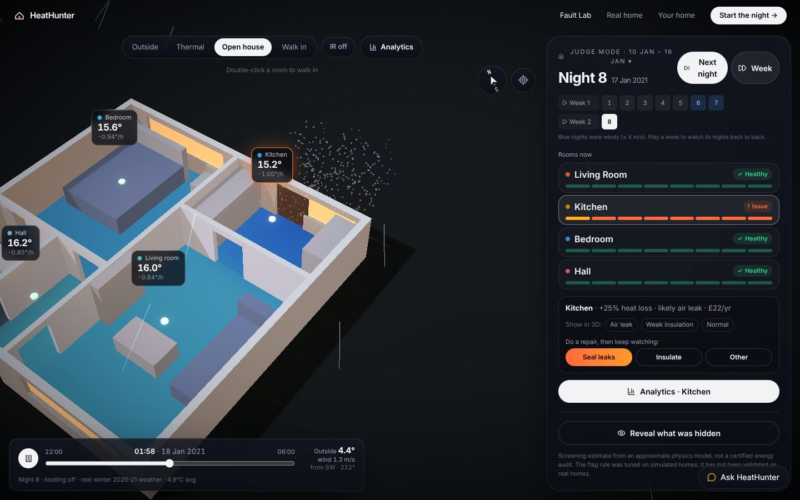
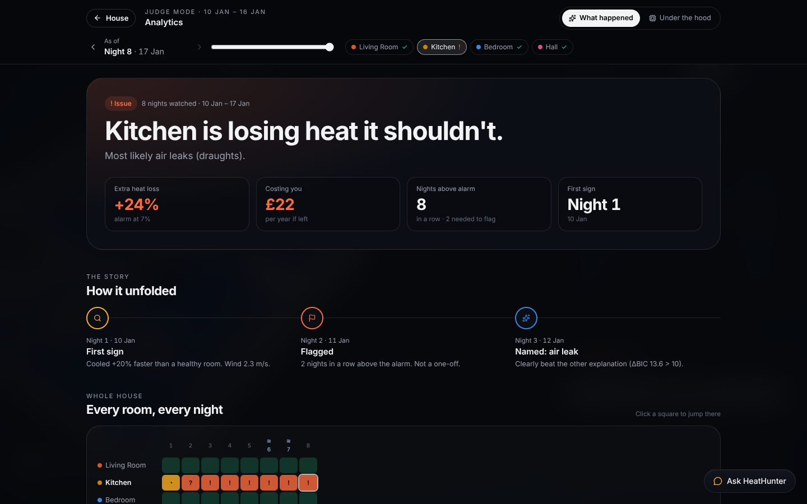
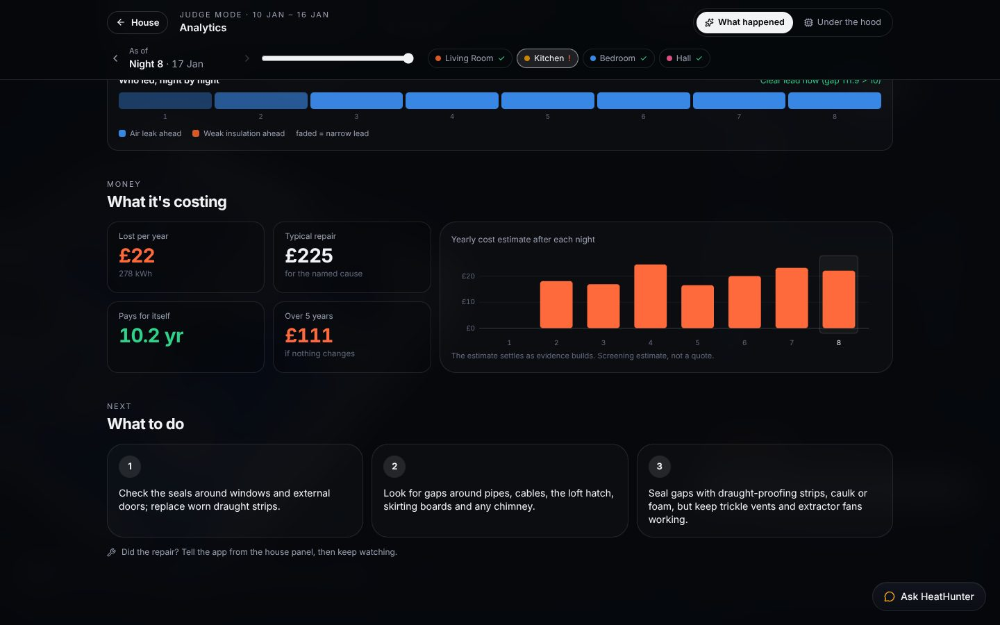
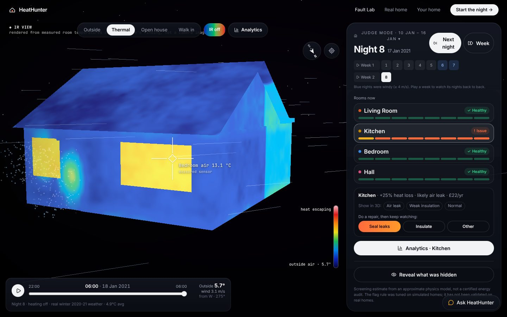
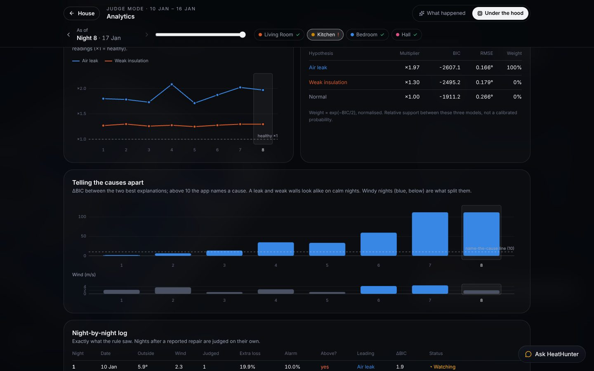

# HeatHunter

**A check-engine light for your home's heat.** A few cheap temperature sensors,
a few cold nights, and physics tells you which room is losing heat, whether it is
an air leak or weak insulation, what it costs you, and whether your repair worked.

Built in 36 hours at **SBUHacks 2026**.



## What it does

1. **Watches a home night after night.** After the heating switches off, every
   room cools down. HeatHunter measures how fast.
2. **Tests three suspects for every room.** Each night it fits three physical
   models to each room's temperature curve: *normal*, *air leak (draughts)* and
   *weak insulation (walls, roof, floor)*. It compares them statistically (BIC).
3. **Uses the wind to tell leaks from walls.** On one calm night a leak and a
   weak wall look almost identical. A leak gets worse when it is windy and a
   wall does not, so several nights of different weather separate them. A room
   is flagged only after **two nights in a row** above its alarm level. The
   cause is named only when one explanation clearly wins.
4. **Puts a price on it.** It estimates the yearly cost in GBP, a typical repair
   cost and the payback time, all from stated UK assumptions.
5. **Confirms your fix.** You do the repair yourself. HeatHunter then judges
   only the nights after it and tells you plainly whether the problem is gone.

## Try it

| | |
|---|---|
| **Fault Lab** | A digital twin of SMETER house HH09, a real bungalow in England, running on real weather from a winter the model never saw. You, a judge, or chance plants a hidden fault. Run night by night or a week at a time and watch it get caught, then reveal the answer. |
| **Analytics** | Two layers for any room, as of any night. *What happened* covers the verdict, a timeline of when it started, every room on every night, the suspects and the cost. *Under the hood* shows the model fits, the cause gap against the wind, and the night-by-night log the rule used. |
| **Infrared view** | A FLIR-style view of the house coloured from measured room temperatures. The crosshair reads out whatever room it points at. |
| **Real home** | A week of real HH09 sensor data replayed in 3D, room by room. |
| **Your home** | Draw or upload a floor plan (Claude can read a plan image), set your town and heating-off hours, then upload sensor logs (CSV). |
| **Ask HeatHunter** | A chat that explains the results on screen in plain English and can move the 3D view. It only explains; the physics does the diagnosing. |

<p>
  
  
  
  
</p>

## How well it works

These results come from **simulated** check houses that were never used for
tuning, run on real weather from the training winter. They are not accuracy on
real homes.

| Simulated check houses | Correct room and cause |
|---|---|
| Weak insulation (×1.6 to ×3) | 35 / 36, typically by night 2–3 |
| Air leaks (×1.6 to ×3) | 30 / 36, typically by night 3–5 (mild ×1.6 leaks are hardest: 8 / 12) |
| Healthy houses wrongly flagged | 1 / 24 |
| Confident but wrong | 2 / 72 |

The whole design rests on one finding: with a **single night**, only **3 of 32**
air leaks could be told apart from wall heat loss. With four nights of mixed
weather, it was 30 of 32. So HeatHunter watches night after night.

Details are in [`docs/PHYSICS.md`](docs/PHYSICS.md) and
[`reports/monitoring/flag_rule_tuning.json`](reports/monitoring/flag_rule_tuning.json).

## How it works

```
 real weather (SMETER HH09 station)        your sensors (CSV) + Open-Meteo weather
            │                                            │
            ▼                                            ▼
  simulator: HH09 digital twin              ┌──────────────────────────────┐
  with a hidden fault  ───────────────────▶ │  engine: per-room thermal     │
  (truth kept private;                      │  model fitted 3 ways each     │
   only Reveal can read it)                 │  night (normal / leak / wall) │
                                            └──────────────┬───────────────┘
                                                           ▼
                                   flag rule: alarm level a + b/√nights per cause,
                                   2 nights in a row, cause named when ΔBIC > 10
                                                           ▼
                                   FastAPI (typed contracts → OpenAPI → TypeScript)
                                                           ▼
                           React + Three.js: 3D house, infrared view, Analytics, chat
```

- **Engine** (`backend/engine/`). Each room has fabric heat storage and an air
  layer, coupled to the outdoors and to neighbouring rooms. Air leakage follows
  the ASHRAE/LBL stack-and-wind law. Windows use SAP 2012 glazing values. The
  engine reads only public inputs, and a test enforces that it never imports
  the simulator.
- **Simulator** (`backend/simulation/`). An approximate digital twin of HH09
  that plants a fault (leak or weak insulation, ×1.2–×3) in one room and
  generates realistic, noisy room temperatures from real weather.
- **Flag rule** (`backend/diagnosis/monitoring.py`). Tuned on 192 simulated
  houses from winter 2019-20, with half held back for checking. The live demo
  runs on the held-out winter 2020-21.
- **Money** (`config/assumptions.json`). Heating degree days from the SMETER
  station, HH09's boiler efficiency (86.7%) and the Ofgem price cap. Repair
  costs are illustrative.
- **API** (`backend/app/`). FastAPI with Pydantic contracts. The TypeScript
  types are generated from OpenAPI, never written by hand.
- **Frontend** (`frontend/`). React 19, Three.js (react-three-fiber) with a
  custom infrared shader, first-person walk-in, d3 charts, Framer Motion and
  Tailwind.

## Run it

Needs Python 3.11+ and Node 20+.

```bash
python3 -m venv .venv
.venv/bin/pip install -e '.[dev,assistant]'
(cd frontend && npm install && npm run build)
cp .env.example .env      # optional: add OPENAI_API_KEY or ANTHROPIC_API_KEY for the chat
.venv/bin/uvicorn backend.app.main:app --port 8000
```

Open <http://127.0.0.1:8000>. The Fault Lab works fully offline. The chat
needs an API key (with only `OPENAI_API_KEY` set it uses OpenAI, otherwise
Claude), and "Your home" needs internet for weather.

```bash
.venv/bin/pytest                # 254 tests
.venv/bin/ruff check backend
```

For frontend development, run the API, then `cd frontend && npm run dev`.
[`docs/DEMO.md`](docs/DEMO.md) has the demo walkthrough, and
[`docs/CONTRACTS.md`](docs/CONTRACTS.md) documents the API.

## Honest limits

- The Fault Lab house is an **approximate** digital twin. Its room temperatures
  and faults are simulated; only its weather is real. We make no claim that the
  real HH09 house has a fault.
- The flag rule was tuned and checked on simulated houses. It has **not** been
  validated on real homes with known faults.
- Costs are screening estimates from stated assumptions, not quotes or a
  certified energy audit.
- The "Real home" week had the heating on, so it is replayed but not diagnosed.

## Data and credits

- **HH09 measurements, floor plan and weather:** Allinson, D. et al. (2024).
  *Technical Evaluation of SMETER Technologies Project Phase 2 Data.* UK Data
  Service, SN 856978. <https://doi.org/10.5255/UKDA-SN-856978>
- **Weather for user homes:** [Open-Meteo](https://open-meteo.com/).
- **Glazing and leakage coefficients:** SAP 2012 and ASHRAE/LBL infiltration model.
- **Earlier prototype data** (kept for history): NOAA Global Hourly observations
  from Islip, NY, in `data/weather/kisp-*.json`. The first single-night design
  and its fan-test experiment are kept in `backend/simulation/` and
  `scripts/poc_loop.py` as research history.

## Team

| | Built |
|---|---|
| **Anuj Dakhara** ([@AnujDakhara7888](https://github.com/AnujDakhara7888)) | Data pipeline (SMETER HH09, weather), evaluation, and the UI with Nikhil |
| **Kailash Anand** ([@kailash-anand](https://github.com/kailash-anand)) | Physics engine, multi-night flag rule, money estimates |
| **Mihir Naik** ([@Mihirnaik17](https://github.com/Mihirnaik17)) | HH09 digital-twin simulator, diagnosis, hidden-fault store |
| **Nikhil Chowdary** ([@Izchowdary](https://github.com/Izchowdary)) | API and contracts, and the UI with Anuj |

We used AI coding assistants (Claude Code) while building.

MIT licensed. See [LICENSE](LICENSE).
